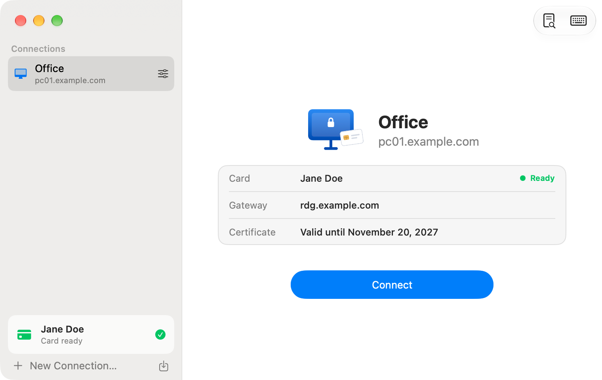

<p align="center">
  
</p>
<h1 align="center">CardGate</h1>
<p align="center">
  Windows Remote Desktop through an RD Gateway with smart card sign-in – for the Mac.
</p>

<p align="center">
  <a href="https://github.com/JK-SW/cardgate/releases/latest"></a>
  <a href="https://github.com/JK-SW/cardgate/releases"></a>
  <a href="LICENSE"></a>
  <a href="docs/user-guide.en.md#requirements"></a>
  <a href="https://github.com/JK-SW/cardgate/actions/workflows/ci.yml"></a>
  <a href="https://ko-fi.com/jirikubinek"></a>
</p>

<p align="center">
  <a href="https://github.com/JK-SW/cardgate/releases/latest">Download</a>
  ·
  <a href="docs/user-guide.en.md">User guide</a>
  ·
  <a href="https://github.com/JK-SW/cardgate/issues/new/choose">Report a bug</a>
  ·
  <a href="CHANGELOG.md">Changelog</a>
  ·
  <a href="README.md">Česky</a>
</p>

A macOS (Apple Silicon) app for connecting to Windows desktops through a Remote Desktop Gateway
that requires **smart card authentication** (the `HTTP_EXTENDED_AUTH_SC` scheme used by mstsc),
with the private key on a card or token accessed through a PKCS#11 module. The card is also
redirected into the session for the Windows sign-in (or, where Windows on the computer does not
accept the card, Windows asks for a password). The connection to the computer uses network
level authentication (Kerberos PKINIT with the card through the gateway's KDC proxy, one PIN), TLS or
RDP Security – by default the strongest the computer accepts.

It bundles a patched [FreeRDP](https://github.com/FreeRDP/FreeRDP) client and adds a native UI:
connection profiles, `.rdp` import, a guarded PIN dialog, card and certificate checks, clear
error messages and a readable connection log whose saved archive hides the computer's and gateway's
names.

<p align="center">
  
</p>

Download the latest build from [Releases](https://github.com/JK-SW/cardgate/releases/latest).
The app is not notarized yet, so macOS blocks its first launch until you click **Open Anyway** in
System Settings → Privacy & Security (why, and how that changes: [Support](#support)).
User guide: [English](docs/user-guide.en.md), [čeština](docs/navod.cs.md),
[slovenčina](docs/navod.sk.md).

## Layout

| Path | Content |
|------|---------|
| `app/CardGate/` | SwiftUI application (Xcode project generated from `app/project.yml`) |
| `app/CardGateKit/` | UI independent logic with unit tests (Swift package) |
| `patches/freerdp/` | Patches applied on top of FreeRDP (gateway smart card auth and macOS fixes) |
| `scripts/` | Reproducible build of FreeRDP and its dependencies (pinned in `scripts/deps.lock`), app bundling |
| `docs/` | User guide |

## Building

Requires Xcode, and `brew install cmake ninja pkg-config xcodegen swiftlint`.

```sh
scripts/build-deps.sh        # FreeRDP and dependencies from pinned sources (once, ~6 min)
scripts/assemble-helper.sh   # self-contained FreeRDP helper
scripts/test.sh              # lint, unit tests, app build, localization check
scripts/ui-test.sh           # UI tests (no card or PIN; needs an unlocked desktop session)
scripts/screenshots.sh       # screenshots of the user guides (docs/images), demo card, light mode
open app/CardGate.xcodeproj  # generated by scripts/generate-project.sh
```

The version is kept only in `VERSION`; changing it on `main` publishes a GitHub Release with the
notes from `CHANGELOG.md` (written in Czech for the app's users).

## Requirements

- Apple Silicon Mac, macOS 15 or newer
- Smart card middleware providing a PKCS#11 module (e.g. ProID+)

## Support

CardGate is free and will stay free. If it helps you, you can support the author on
[Ko-fi](https://ko-fi.com/jirikubinek).

Donations go first towards **signing the app with Apple** (Apple Developer Program, USD 99 a year).
Once signed, macOS no longer blocks the app on first launch, the **Open Anyway** step goes away
and installation gets simpler for everyone.

## Reporting a problem

| What happened | Where to report it |
|---|---|
| Something does not work, a wrong message, an idea | **Publicly** in [Issues](https://github.com/JK-SW/cardgate/issues/new/choose): choose *Bug* or *Idea*. |
| A security problem: someone could get the PIN, misuse the card, fake the gateway or an update, or get around the app's protections | **Privately** through [Report a vulnerability](https://github.com/JK-SW/cardgate/security/advisories/new) (only the author sees it), not in Issues. See [SECURITY.md](SECURITY.md). |

If unsure, report privately. Only the latest version is supported, so update first (**CardGate → Check for
Updates…**). For a bug, attach the archive from **Window → Connection Log → Save Log…**: it holds the CardGate
and macOS versions, the card software and the log, with the names of the computer and gateway, the connection
name and the Windows account replaced with `***`, so it can be attached as it is. Never include a PIN or
a certificate; replace real gateway and computer addresses in the description and screenshots, e.g. with
`gateway.example.com`.

## License

Apache License 2.0, see [LICENSE](LICENSE). Bundled third-party components keep
their own licenses (FreeRDP – Apache 2.0, OpenSSL – Apache 2.0, SDL and
SDL_ttf – zlib, FreeType – FreeType License, cJSON and Sparkle – MIT, MIT Kerberos –
MIT and similar permissive licenses, see its NOTICE).

## AI assistance

CardGate was developed with the help of AI (Claude by Anthropic), which assisted with design,
code, tests and documentation. The author directed the development, decided on the changes and
tested the app with a real smart card.
