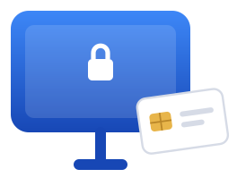
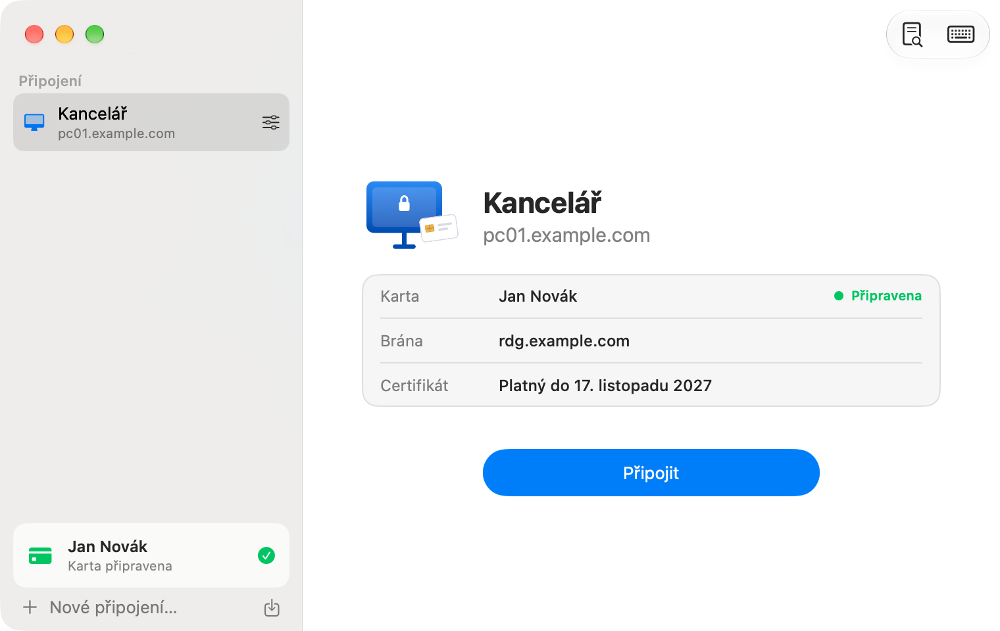

  

<h1 align="center">CardGate</h1>

  Vzdálená plocha Windows přes RD Gateway s přihlášením čipovou kartou – pro Mac.

  
  
  
  
  
  

  <a href="https://github.com/JK-SW/cardgate/releases/latest">Stáhnout</a>
  ·
  <a href="docs/navod.cs.md">Návod</a>
  ·
  <a href="https://github.com/JK-SW/cardgate/issues/new/choose">Nahlásit chybu</a>
  ·
  <a href="CHANGELOG.md">Změny</a>
  ·
  <a href="README.en.md">English</a>

Aplikace pro Mac (Apple Silicon), která připojí ke vzdálené ploše Windows přes **Vzdálenou bránu
(RD Gateway) s přihlášením čipovou kartou**. Klasičtí klienti pro Mac (Windows App a další) tento
způsob přihlášení k bráně neumí. CardGate ano, včetně přihlášení kartou do samotného Windows.

- Velké tlačítko **Připojit**, nastavení připojení a import souborů `.rdp` od IT oddělení.
- Vlastní okno pro zadání PINu s ochranou proti nechtěnému chybnému PINu; PIN se nikde neukládá.
- Kontrola karty a certifikátu (upozorní na blížící se konec platnosti), srozumitelné chybové hlášky.
- Zabezpečení připojení k počítači NLA, TLS nebo Zabezpečení RDP, automaticky to nejsilnější, které
  počítač přijme; s NLA stačí jeden PIN i pro přihlášení do Windows.
- Přihlášení do Windows kartou, nebo jménem a heslem tam, kde Windows na počítači kartu nepřijme.
- Celá obrazovka, více monitorů, schránka, zvuk, přesměrování karty do vzdálené plochy.
- Udržení připojení a obnovení po krátkém výpadku sítě bez nového PINu; Mac během připojení neusne.
- Čeština, slovenština a angličtina.

  

## Stažení a instalace

1. Nainstalujte software ke své čipové kartě s modulem PKCS#11 (např. **ProID+** od Monet+).
2. Stáhněte `CardGate-….zip` z [posledního vydání](https://github.com/JK-SW/cardgate/releases/latest)
   a poklepáním ho rozbalte.
3. Přetáhněte **CardGate** do složky **Aplikace**.
4. Při prvním spuštění macOS aplikaci zablokuje, protože není notarizovaná Applem. Otevřete
   **Nastavení systému → Soukromí a zabezpečení** a klikněte na **Přesto otevřít**.
   (Proč a jak to změnit: [Podpora](#podpora).)

Podrobný návod: [čeština](docs/navod.cs.md) · [slovenčina](docs/navod.sk.md) ·
[English](docs/user-guide.en.md). Změny v jednotlivých verzích: [CHANGELOG](CHANGELOG.md).

**Požadavky:** Mac s Apple Silicon (M1 a novější), macOS 15 nebo novější, software ke kartě
s modulem PKCS#11.

## Podpora

CardGate je zdarma a takový zůstane. Pokud vám pomáhá, můžete autora podpořit na
[Ko-fi](https://ko-fi.com/jirikubinek).

Příspěvky půjdou nejdřív na **podpis aplikace od Applu** (Apple Developer Program, 99 USD ročně).
S ním macOS aplikaci při prvním spuštění neblokuje, odpadne krok **Přesto otevřít** a instalace
bude jednodušší pro všechny.

## Nahlášení problému

| Co se stalo | Kam to nahlásit |
|---|---|
| Něco nefunguje, chybná hláška, nápad na vylepšení | **Veřejně** v [Issues](https://github.com/JK-SW/cardgate/issues/new/choose) – vyberte *Chyba* nebo *Námět*. |
| Bezpečnostní problém: může někdo získat PIN, zneužít kartu, podvrhnout bránu nebo aktualizaci, obejít ochranu aplikace | **Neveřejně** přes [Report a vulnerability](https://github.com/JK-SW/cardgate/security/advisories/new) (vidí to jen autor). Ne do Issues. Podrobnosti v [SECURITY.md](SECURITY.md). |

Pokud si nejste jistí, hlaste neveřejně. K chybě pomůže verze CardGate (menu **CardGate → O aplikaci CardGate**),
verze macOS, typ karty a log připojení (menu **Okno → Log připojení → Kopírovat log**).
Nikdy nepřikládejte PIN, certifikát ani skutečné adresy brány a počítače – nahraďte je např.
`gateway.example.com`.

## Licence

Apache License 2.0, viz [LICENSE](LICENSE). Aplikace obsahuje upravený klient
[FreeRDP](https://github.com/FreeRDP/FreeRDP) a další komponenty s vlastními licencemi
(FreeRDP a OpenSSL – Apache 2.0, SDL a SDL_ttf – zlib, FreeType – FreeType License, cJSON a Sparkle
– MIT, MIT Kerberos – licence MIT a další podobné, viz jeho NOTICE); jejich texty jsou v aplikaci
v okně **O aplikaci**.

## Vývoj s pomocí AI

Při vývoji CardGate byla použita umělá inteligence (Claude od Anthropicu): pomáhala s návrhem,
kódem, testy a dokumentací. Autor vývoj řídil, o změnách rozhodoval a aplikaci testoval se
skutečnou kartou.

Autor: Ing. Jiří Kubínek
