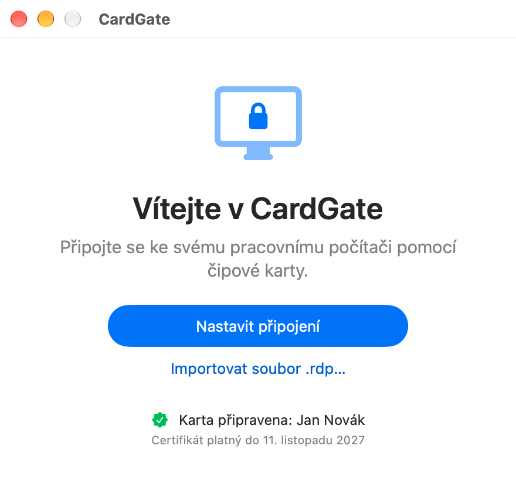
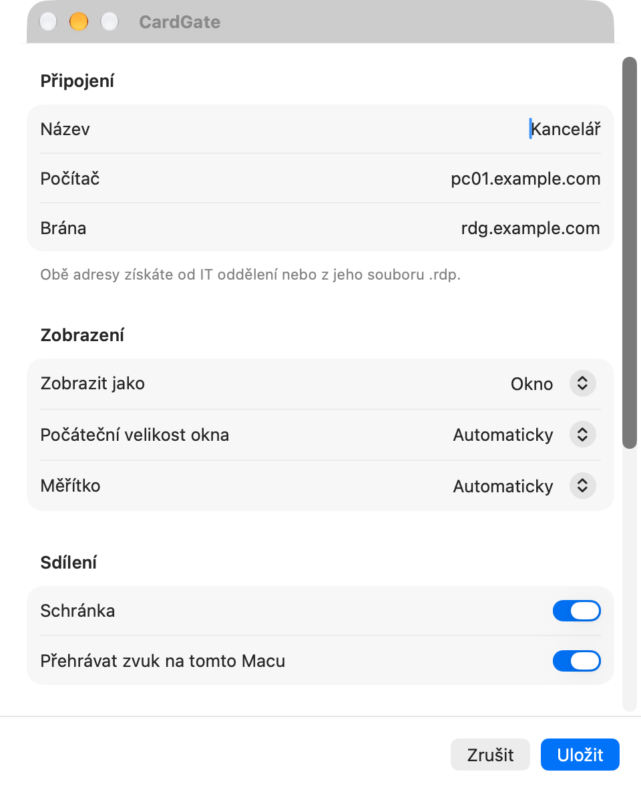
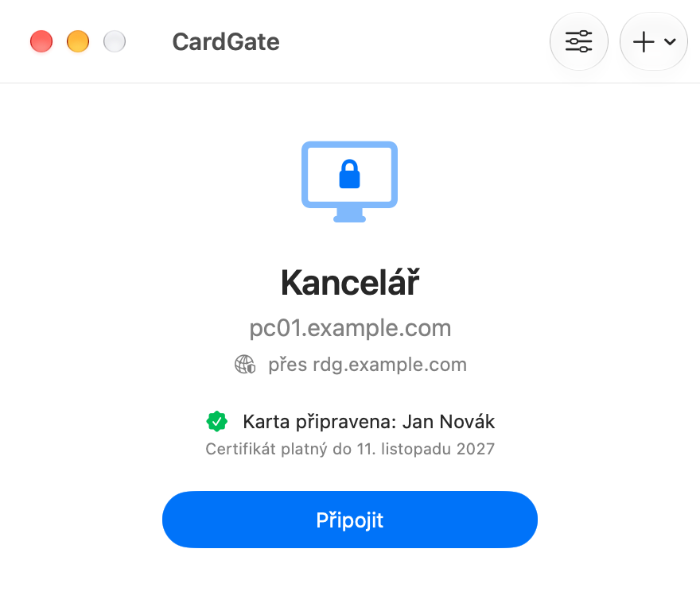
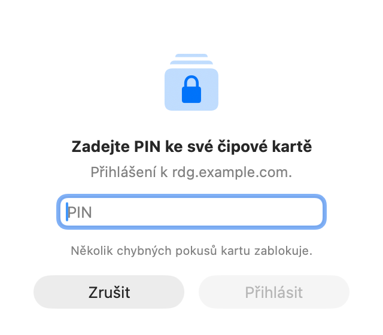
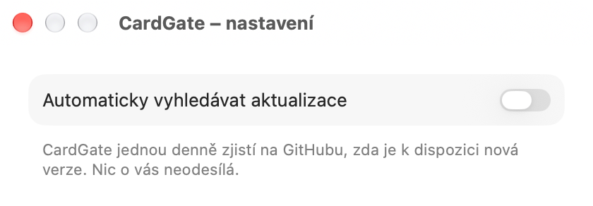

# CardGate – návod

CardGate připojí váš Mac ke vzdálené ploše pracovního počítače přes bránu (RD Gateway),
která vyžaduje přihlášení čipovou kartou nebo tokenem.
Tento návod otevřete i z aplikace: **Nápověda → Návod k CardGate**.

## Co budete potřebovat

- Mac s procesorem Apple (M1 a novější), macOS 15 nebo novější.
- Čipovou kartu se čtečkou nebo USB token.
- Software ke kartě s modulem PKCS#11, např. **ProID+** pro macOS.
- Adresu svého pracovního počítače a brány (dostanete od IT oddělení, případně jako soubor `.rdp`).

## Instalace

1. Stáhněte `CardGate-X.Y.Z.zip` ze stránky Releases a rozbalte ho (dvojklik).
2. Přetáhněte **CardGate** do složky **Aplikace**.
3. Při prvním spuštění macOS aplikaci zablokuje, protože není notarizovaná u Applu.
   Klikněte na **Hotovo**, otevřete **Nastavení systému → Soukromí a zabezpečení**, sjeďte dolů
   k hlášce o aplikaci CardGate a klikněte na **Přesto otevřít**. Potvrďte heslem a znovu **Otevřít**.
   Tento krok je potřeba jen jednou (a po každé aktualizaci).

## Nastavení připojení

1. Spusťte CardGate a klikněte na **Nastavit připojení**
   (nebo **Importovat soubor .rdp…**, pokud vám ho IT oddělení poslalo). Připojujte se jen k adresám
   od IT oddělení: po dobu připojení může vzdálený počítač používat vaši kartu.
2. Vyplňte **Počítač** (např. `pc01.example.com`) a **Bránu**.
3. Volitelně zvolte zobrazení (výchozí je celá obrazovka, nebo okno), počáteční velikost okna, měřítko
   (velikost textu a aplikací ve Windows; **Automaticky** = 200 % na displeji Retina, jinak 100 %),
   schránku, zvuk a směr posouvání myší. Klikněte na **Uložit**.

Připojení můžete mít i více – přepínáte je v horní liště okna.




## Připojení

1. Vložte kartu nebo token.
2. Klikněte na **Připojit**. Dokud se plocha neotevře, můžete pokus ukončit tlačítkem **Zrušit**.
3. Zadejte **PIN** ke kartě. Pozor: po několika chybných pokusech se karta zablokuje.
4. Otevře se okno se vzdálenou plochou a okno CardGate se schová. V Docku je stále jen ikona
   CardGate: kliknutím na ni (nebo přes ⌘Tab) se vrátíte ke vzdálené ploše. Zelené tlačítko
   v záhlaví okna přepíná celou obrazovku. Pravým tlačítkem na ikoně v Docku zvolíte **Odpojit**.
5. Po odpojení nebo zavření vzdálené plochy se okno CardGate zase zobrazí.

V **CardGate → Nastavení…** (⌘,) jsou tři volby, všechny výchozí zapnuté:
- **Udržovat připojení a po výpadku ho obnovit** – při krátkém výpadku sítě se CardGate připojí
  znovu sám, bez nového PINu. Plocha mezitím ukazuje poslední obraz a nereaguje; nad ní je okénko
  „Připojení se přerušilo. Obnovuji…“ s tlačítkem Odpojit. Po 2,5–5 minutách to vzdá.
- **Během připojení nenechat Mac usnout** – Mac při nečinnosti neusne a připojení vydrží; displej může
  zhasnout podle nastavení macOS. Zavření víka nebo ruční uspání Mac uspí i tak.
- **Ptát se před odpojením** – zavření okna vzdálené plochy (nebo ⌘Q v něm) se nejdřív zeptá.
  **Odpojit** v CardGate nebo v Docku se neptá.




Klávesové zkratky klienta (celá obrazovka, odpojení…) se používají s klávesami
**levý Control + levý Option + levý Shift** a písmenem (např. **Enter** = celá obrazovka).

## Aktualizace

Při druhém spuštění se CardGate zeptá, zda má nové verze hledat automaticky (jednou denně).
Volbu změníte v **CardGate → Nastavení…** (⌘,).
Ručně: menu **CardGate → Zkontrolovat aktualizace…**. Nová verze se nainstaluje jedním kliknutím;
aplikace přijme jen aktualizaci podepsanou klíčem autora. Kontrola jen stáhne seznam verzí
z GitHubu a nic o vás neodesílá.



## Bezpečnost

- PIN se nikde neukládá. Dialog pro PIN přijme jen PIN v délce, jakou karta povoluje, a upozorní,
  když už byl dříve zadán chybný PIN nebo jde o poslední pokus. Po dobu připojení zůstává PIN jen
  v paměti klienta (pro přihlášení do Windows a obnovení po výpadku); PIN, který karta odmítne,
  se už nikdy znovu nepoužije.
- Po dobu připojení je karta zpřístupněna vzdálenému počítači (kvůli přihlášení do Windows).
  Programy ve vzdálené relaci ji mohou používat stejně, jako by byla vložená přímo v něm.
  Po skončení práce se odpojte, případně kartu vytáhněte.
- Aplikace se připojí jen k bráně s důvěryhodným certifikátem. Pokud ohlásí nedůvěryhodný
  certifikát, nepokračujte a kontaktujte IT oddělení.
- Certifikát brány musí vydat veřejně důvěryhodná certifikační autorita. Certifikát vnitřní
  (firemní) autority aplikace nepřijme, i když mu Mac důvěřuje (např. v Klíčence nebo přes
  správu zařízení) – ohlásí, že certifikát brány není veřejně důvěryhodný.

## Když něco nefunguje

| Hlášení | Co dělat |
|---|---|
| Na kartě nebyl nalezen certifikát | Vytáhněte kartu/token, znovu zasuňte a zkuste znovu. |
| Software pro čipovou kartu nebyl nalezen | Nainstalujte software ke kartě (např. ProID+). |
| Chybný PIN | Zadejte správný PIN – opakované chyby kartu zablokují. |
| Karta přihlášení odmítla | PIN mohl být chybný, nebo selhala karta či čtečka. Vytáhněte kartu, vložte ji znovu a připojte se. Opakované chybné PINy kartu zablokují. |
| Typ klíče na kartě není podporován | K bráně se lze přihlásit jen kartou s klíčem RSA. Obraťte se na IT oddělení. |
| Bránu nelze kontaktovat | Zkontrolujte připojení k internetu a adresu brány. |
| Připojení nemá zadanou bránu | CardGate se připojuje jen přes bránu. Klikněte na **Upravit připojení** a doplňte adresu brány. |
| Spojení bylo přerušeno | Síť vypadla a obnovení se nepodařilo (nebo je v Nastavení vypnuté). Zkontrolujte připojení k internetu a připojte se znovu. |
| Modul čipové karty není od ověřeného vydavatele | Modul ke kartě nepochází od ověřeného výrobce. Použijte ho (**Použít tento modul…**), jen pokud víte, odkud je (např. od IT oddělení). |
| Modul čipové karty nastavený pro toto připojení nebyl nalezen | Opravte cestu v **Upravit připojení** (část Karta), nebo ji nechte prázdnou. |

Podrobnosti najdete v menu **Okno → Log připojení**; tlačítkem **Kopírovat log** ho můžete
poslat IT oddělení. Log neobsahuje PIN.
Logy posledních pěti připojení jsou také ve složce `~/Library/Logs/CardGate`.

Chybu aplikace nebo námět nahlaste v [Issues](https://github.com/JK-SW/cardgate/issues) (log před vložením zkontrolujte a adresy
nahraďte např. `pc01.example.com`). Bezpečnostní problém hlaste neveřejně
([Report a vulnerability](https://github.com/JK-SW/cardgate/security/advisories/new)).

## Pro správce IT

Po delším používání (20 úspěšných připojení, nejdřív za týden) aplikace jednou nenápadně nabídne
podporu autora; po zavření se už nikdy neukáže. Nabídku lze plošně vypnout:

```sh
defaults write io.github.jk-sw.cardgate DonationPromptDisabled -bool true
```

(nebo konfiguračním profilem pro doménu `io.github.jk-sw.cardgate`).
