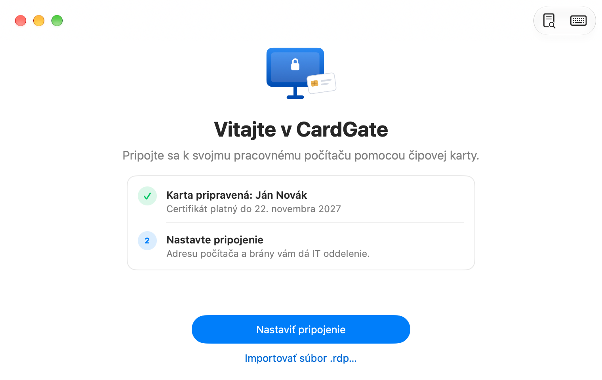
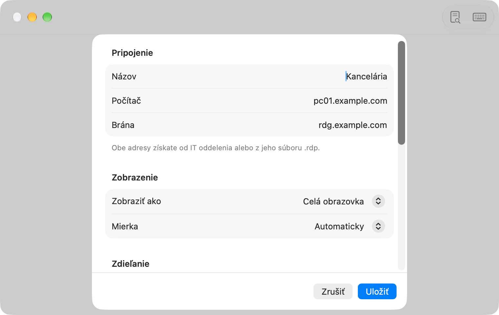
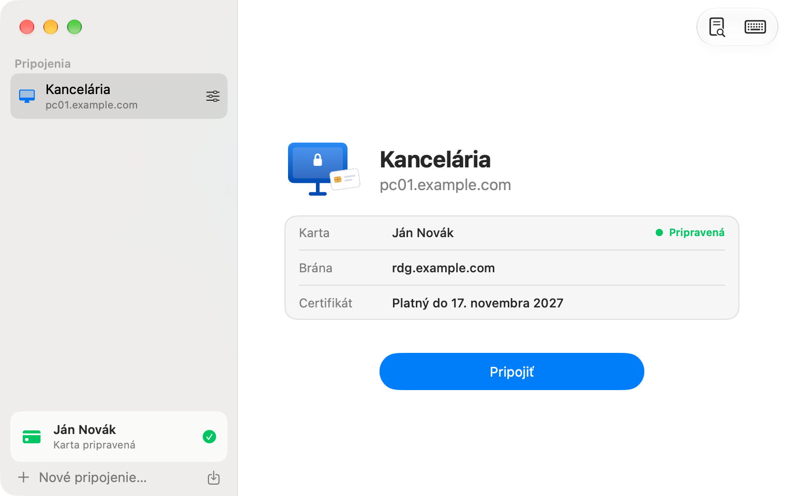
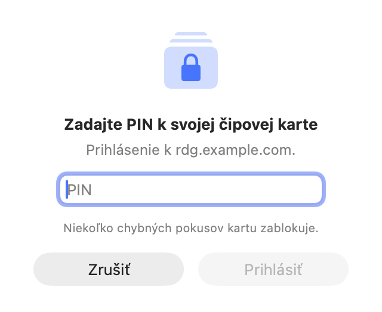
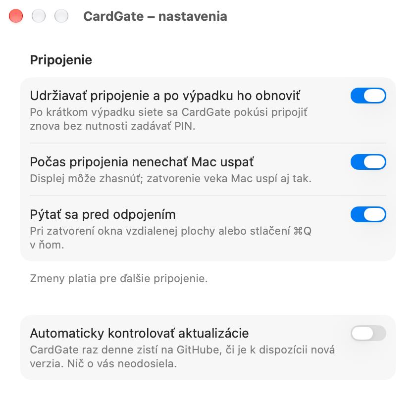

# CardGate – návod

CardGate pripojí váš Mac k vzdialenej ploche pracovného počítača cez bránu (RD Gateway),
ktorá vyžaduje prihlásenie čipovou kartou alebo tokenom.
Tento návod otvoríte aj z aplikácie: **Pomocník → Návod na CardGate**.

## Čo budete potrebovať

- Mac s procesorom Apple (M1 a novší), macOS 15 alebo novší.
- Čipovú kartu s čítačkou alebo USB token.
- Softvér ku karte s modulom PKCS#11, napr. **ProID+** pre macOS.
- Adresu svojho pracovného počítača a brány (dostanete od IT oddelenia, prípadne ako súbor `.rdp`).

## Inštalácia

1. Stiahnite `CardGate-X.Y.Z.zip` zo stránky Releases a rozbaľte ho (dvojklik).
2. Presuňte **CardGate** do priečinka **Aplikácie**.
3. Pri prvom spustení macOS aplikáciu zablokuje, pretože nie je notarizovaná u Apple.
   Kliknite na **Hotovo**, otvorte **Nastavenia systému → Súkromie a bezpečnosť**, posuňte sa nadol
   k hláseniu o aplikácii CardGate a kliknite na **Aj tak otvoriť**. Potvrďte heslom a znova **Otvoriť**.
   Tento krok je potrebný len raz.

## Nastavenie pripojenia

1. Spustite CardGate a kliknite na **Nastaviť pripojenie**
   (alebo **Importovať súbor .rdp…**, ak vám ho IT oddelenie poslalo). Pripájajte sa len k adresám
   od IT oddelenia: počas pripojenia môže vzdialený počítač používať vašu kartu.
2. Vyplňte **Počítač** (napr. `pc01.example.com`) a **Bránu**.
3. Voliteľne zvoľte zobrazenie (predvolená je celá obrazovka, alebo okno), pri celej obrazovke s viacerými
   displejmi aj displej (**Hlavný displej** = ten s lištou menu; keď zvolený displej nie je pripojený, otvorí sa
   na hlavnom), počiatočnú veľkosť okna (**Automaticky** = 80 % obrazovky), mierku (veľkosť textu a aplikácií vo
   Windows; **Automaticky** = 200 % na displeji Retina, inak 100 %), schránku, zvuk a smer posúvania myšou.
   Kliknite na **Uložiť**.

Pripojení môžete mať aj viac: sú v zozname vľavo. Každé upravíte tlačidlom vedľa jeho názvu, nové
pridáte tlačidlom **Nové pripojenie…** pod zoznamom.

Menej používané voľby sú v časti **Pokročilé** (otvorí sa kliknutím; certifikát karty, zabezpečenie,
prihlásenie do Windows a modul karty). **Zabezpečenie** nechajte na **Automaticky**: CardGate použije
najsilnejšie zabezpečenie, ktoré počítač prijme (NLA, TLS, alebo Zabezpečenie RDP), zapamätá si ho a
približne po mesiaci skúsi, či počítač neprijme silnejšie. V zátvorke je vidieť, čo sa práve používa, napr.
**Automaticky (NLA)**. NLA, TLS alebo Zabezpečenie RDP voľte len na pokyn IT oddelenia.

**Prihlásenie do Windows**: predvolené **Kartou** prihlási do Windows kartou (s NLA bez ďalšieho PINu). Ak
Windows na počítači prihlásenie kartou neprijme (napr. pred prihlasovacou obrazovkou ukáže chybu), zvoľte
**Menom a heslom**: k bráne vás karta prihlási ďalej, Windows však ukáže svoju prihlasovaciu obrazovku a
opýta sa na heslo. Ak Windows ponúkne PIN karty, zvoľte **Možnosti prihlásenia** a heslo; nabudúce zvyčajne
ponúkne rovno heslo. Karta zostane vo Windows k dispozícii (napr. na podpisy).




## Pripojenie

1. Vložte kartu alebo token.
2. Kliknite na **Pripojiť**. Kým sa plocha neotvorí, môžete pokus ukončiť tlačidlom **Zrušiť**.
3. Zadajte **PIN** ku karte. Pozor: po niekoľkých chybných pokusoch sa karta zablokuje.
   S NLA vás tento PIN prihlási aj do Windows. Bez NLA si Windows na prihlasovacej obrazovke vypýta PIN
   ešte raz (ak ponúkne heslo, zvoľte prihlásenie čipovou kartou).
4. Otvorí sa okno so vzdialenou plochou a okno CardGate sa skryje. V Docku je stále len ikona
   CardGate: kliknutím na ňu (alebo cez ⌘Tab) sa vrátite k vzdialenej ploche. Zelené tlačidlo
   v záhlaví okna prepína celú obrazovku. Pravým tlačidlom na ikone v Docku zvolíte **Odpojiť**.
   Vpravo v záhlaví je mierka vzdialenej plochy (napr. 150 %): lupami ju zmenšíte alebo zväčšíte,
   kliknutím na číslo vyberiete zo zoznamu (aj mierku pri pripojení). Windows zmení veľkosť textu
   a aplikácií hneď, bez odpojenia; pri ďalšom pripojení platí opäť mierka z nastavenia pripojenia.
   Tlačidlo vedľa otvorí log pripojenia. Na celej obrazovke sa záhlavie ukáže po prejdení myšou k hornému okraju.
5. Po odpojení alebo zatvorení vzdialenej plochy sa okno CardGate znova zobrazí.

V **CardGate → Nastavenia…** (⌘,) sú tri voľby, všetky predvolene zapnuté:
- **Udržiavať pripojenie a po výpadku ho obnoviť** – pri krátkom výpadku siete sa CardGate pripojí
  znova sám, bez nového PINu. Plocha medzitým ukazuje posledný obraz a nereaguje; nad ňou je okienko
  „Pripojenie sa prerušilo. Obnovujem…“ s tlačidlom Odpojiť. Po 2,5–5 minútach to vzdá. Karta musí byť
  v čítačke: bez nej sa obnova nepodarí (CardGate ukáže, že na karte nenašiel certifikát).
- **Počas pripojenia nenechať Mac uspať** – Mac sa pri nečinnosti neuspí a pripojenie vydrží; displej
  môže zhasnúť podľa nastavení macOS. Zatvorenie veka alebo ručné uspanie Mac uspí aj tak.
- **Pýtať sa pred odpojením** – zatvorenie okna vzdialenej plochy (alebo ⌘Q v ňom) sa najprv opýta.
  **Odpojiť** v CardGate alebo v Docku sa nepýta.




Klávesové skratky klienta sa používajú s klávesmi **ľavý Control + ľavý Option + ľavý Shift**
a písmenom (napr. **Enter** = celá obrazovka).

## Aktualizácie

Pri druhom spustení sa CardGate opýta, či má nové verzie hľadať automaticky (raz denne).
Voľbu zmeníte v **CardGate → Nastavenia…** (⌘,).
Ručne: menu **CardGate → Skontrolovať aktualizácie…**. Nová verzia sa nainštaluje jedným kliknutím;
aplikácia prijme len aktualizáciu podpísanú kľúčom autora. Kontrola len stiahne zoznam verzií
z GitHubu a nič o vás neodosiela.



## Bezpečnosť

- PIN sa nikde neukladá. Dialóg na PIN prijme len PIN v dĺžke, akú karta povoľuje, a upozorní,
  keď už bol skôr zadaný chybný PIN alebo ide o posledný pokus. Počas pripojenia zostáva PIN len
  v pamäti klienta (na prihlásenie do Windows a obnovenie po výpadku); PIN, ktorý karta odmietne,
  sa už nikdy znova nepoužije.
- Počas pripojenia je karta sprístupnená vzdialenému počítaču (kvôli prihláseniu do Windows).
  Programy vo vzdialenej relácii ju môžu používať rovnako, ako keby bola vložená priamo v ňom.
  Po skončení práce sa odpojte, prípadne kartu vytiahnite.
- Aplikácia sa pripojí len k bráne s dôveryhodným certifikátom. Ak ohlási nedôveryhodný
  certifikát, nepokračujte a kontaktujte IT oddelenie.
- Certifikát brány musí vydať verejne dôveryhodná certifikačná autorita. Certifikát internej
  (firemnej) autority aplikácia neprijme, aj keď mu Mac dôveruje (napr. v Kľúčenke alebo cez
  správu zariadení) – ohlási, že certifikát brány nie je verejne dôveryhodný.
- Spojenie medzi bránou a počítačom je pri NLA a TLS šifrované protokolom TLS. Zabezpečenie RDP používa
  staršiu šifru RC4; automatika ho použije len pri počítači, ktorý nič iné neprijme. S NLA navyše
  počítač overí vašu kartu ešte pred zobrazením prihlasovacej obrazovky.
- Certifikát počítača si CardGate zapamätá pri prvom pripojení. Keď sa neskôr zmení, pripojenie
  zastaví (**Certifikát počítača sa zmenil**). Tlačidlom **Dôverovať novému certifikátu** ho prijmite,
  len keď správca počítača potvrdí, že bol obnovený, a jeho odtlačok SHA-256 súhlasí s odtlačkom v hlásení.
  S NLA prijme CardGate obnovený certifikát sám: počítač pri prihlásení kartou (Kerberos) preukáže, že je
  to stále on, ešte predtým, ako mu CardGate pošle vaše prihlasovacie údaje.
- Automatické zabezpečenie nikdy potichu neprejde na slabšie. Keď počítač predtým prijímal TLS alebo NLA
  a teraz ponúka len slabšie zabezpečenie, CardGate sa nepripojí, kým nekliknete na **Pripojiť sa
  slabším zabezpečením**; bez potvrdenia správcu to nerobte.

## Keď niečo nefunguje

| Hlásenie | Čo robiť |
|---|---|
| Na karte sa nenašiel certifikát | Vytiahnite kartu/token, znova zasuňte a skúste znova. |
| Softvér pre čipovú kartu sa nenašiel | Nainštalujte softvér ku karte (napr. ProID+). |
| Chybný PIN | Zadajte správny PIN – opakované chyby kartu zablokujú. |
| Karta prihlásenie odmietla | PIN mohol byť chybný, alebo zlyhala karta či čítačka. Vytiahnite kartu, vložte ju znova a pripojte sa. Opakované chybné PINy kartu zablokujú. |
| Typ kľúča na karte nie je podporovaný | K bráne sa dá prihlásiť len kartou s kľúčom RSA. Kontaktujte IT oddelenie. |
| Bránu nie je možné kontaktovať | Skontrolujte pripojenie k internetu a adresu brány. |
| Pripojenie nemá zadanú bránu | CardGate sa pripája len cez bránu. Kliknite na **Upraviť pripojenie** a doplňte adresu brány. |
| Spojenie bolo prerušené | Sieť vypadla a obnovenie sa nepodarilo (alebo je v Nastaveniach vypnuté). Skontrolujte pripojenie k internetu a pripojte sa znova. |
| Modul čipovej karty nie je od overeného vydavateľa | Modul ku karte nepochádza od overeného výrobcu. Použite ho (**Použiť tento modul…**), len ak viete, odkiaľ je (napr. od IT oddelenia). |
| Modul čipovej karty nastavený pre toto pripojenie sa nenašiel | Opravte cestu v **Upraviť pripojenie** (časť Pokročilé), alebo ju nechajte prázdnu. |
| Počítač vyžaduje silnejšie zabezpečenie pripojenia | V nastaveniach pripojenia zvoľte **Zabezpečenie: Automaticky**. Ak už je zvolené, počítač vyžaduje NLA, ktoré sa nepodarilo použiť – postupujte podľa hlásenia, prípadne kontaktujte IT oddelenie. |
| Počítač ponúka len slabšie zabezpečenie pripojenia | Ak to správca počítača zmenil zámerne, kliknite na **Pripojiť sa slabším zabezpečením**. Inak sa nepripájajte a kontaktujte IT oddelenie. |
| Certifikát počítača sa zmenil | Novému certifikátu dôverujte, len keď správca potvrdí jeho obnovenie a odtlačok (pozri Bezpečnosť). |
| Váš účet sa k tomuto počítaču nesmie pripojiť | Požiadajte správcu počítača o pridanie do skupiny Používatelia vzdialenej pracovnej plochy. |
| Čas na Macu sa líši od času v doméne | Skontrolujte dátum a čas v Nastaveniach systému → Všeobecné → Dátum a čas a pripojte sa znova. |
| Doména tento počítač nepozná | V nastaveniach pripojenia zadajte celé meno počítača s doménou (napr. `pc01.example.com`). |
| Brána nepovoľuje pripojenie k tomuto počítaču | Skontrolujte celé meno počítača; ak je správne, kontaktujte IT oddelenie. |
| Brána je dočasne nedostupná | Brána je preťažená alebo v údržbe. Skúste to o chvíľu znova. |
| Váš účet je zakázaný / zablokovaný, Platnosť vášho účtu skončila | Kontaktujte IT oddelenie. |
| Počítač nemá licenciu pre vzdialenú plochu | Kontaktujte IT oddelenie. |
| Program vzdialenej plochy neočakávane skončil | Pripojte sa znova. Ak sa to opakuje, nahláste chybu v Issues a priložte archív z **Uložiť log…** (pozri nižšie). |
| Windows pri prihlásení kartou ukáže chybu (napr. „Hash generation … is not enabled on the server“) | Windows na tomto počítači prihlásenie kartou neprijíma. V nastaveniach pripojenia zvoľte **Prihlásenie do Windows: Menom a heslom**. |
| Prihlásenie k počítaču kartou sa nepodarilo | Pripojte sa znova, CardGate sa potom pripojí bez NLA. Ak počítač NLA vyžaduje, kontaktujte IT oddelenie (brána potrebuje KDC proxy). |
| Pri tomto pripojení nemožno použiť NLA | Zadajte celé meno počítača s doménou (napr. `pc01.example.com`) a skontrolujte pripojenie k internetu, prípadne k sieti organizácie (kvôli stiahnutiu certifikačnej autority karty). |

Podrobnosti nájdete v menu **Okno → Log pripojenia**. V predvolenom zobrazení **Dôležité** ukazuje
zrozumiteľne priebeh pripojenia: upozornenia oranžovo (napr. slabšie zabezpečenie RDP, výpadok
siete alebo vybratie karty z čítačky), chyby červeno. V zobrazení **Podrobnosti** uvidíte všetky
riadky logu; známe neškodné správy sú sivé. Tlačidlo **Kopírovať log** skopíruje to, čo okno práve
ukazuje (dôležité správy, alebo celý log). **Uložiť log…** uloží archív ZIP s tromi súbormi – dôležité
správy (`important.txt`), celý log so všetkými podrobnosťami (`connection.log`) a anonymné diagnostické
údaje (`diagnostics.txt`: verzia aplikácie a macOS, model Macu, displeje, softvér a typ karty, nastavenia
pripojenia bez adries) – aby ste ho mohli poslať IT oddeleniu. Mená počítača a brány, názov pripojenia
a účet Windows sú v archíve nahradené `***`, takže ho môžete poslať bez úprav. Log nikdy neobsahuje PIN.
Logy posledných piatich pripojení sú aj v priečinku `~/Library/Logs/CardGate`.

Chybu aplikácie alebo námet nahláste v [Issues](https://github.com/JK-SW/cardgate/issues) a priložte archív
z **Uložiť log…** (skopírovaný log mená počítača a brány obsahuje). Bezpečnostný problém hláste neverejne
([Report a vulnerability](https://github.com/JK-SW/cardgate/security/advisories/new)).

## Pre správcov IT

Po dlhšom používaní (20 úspešných pripojení, najskôr po týždni) aplikácia raz nenápadne ponúkne
podporu autora; po zatvorení sa už nikdy neukáže. Ponuku možno plošne vypnúť:

```sh
defaults write io.github.jk-sw.cardgate DonationPromptDisabled -bool true
```

(alebo konfiguračným profilom pre doménu `io.github.jk-sw.cardgate`).

**Zabezpečenie pripojenia k počítaču.** CardGate podporuje NLA, TLS aj Zabezpečenie RDP; automatika použije
najsilnejšie, ktoré počítač prijme. Odporúčame NLA (jeden PIN, počítač overí kartu pred prihlásením).
NLA s kartou potrebuje:
- na bráne RD Gateway zverejnenú službu KDC proxy (`https://<brána>/KdcProxy`), cez ktorú CardGate
  overí kartu u radiča domény (Kerberos PKINIT),
- meno počítača v DNS doméne Active Directory: realm je prípona mena veľkými písmenami
  (`pc01.example.com` → `EXAMPLE.COM`); pri počítači v inej DNS zóne NLA zlyhá a CardGate sa pripojí bez neho,
- certifikáty radičov domény vydané pod rovnakou koreňovou certifikačnou autoritou ako certifikáty kariet
  (CardGate ju stiahne podľa adries v certifikáte karty a uloží),
- používateľa s oprávnením prihlásiť sa cez Vzdialenú pracovnú plochu,
- čas na Macu zhodný s časom v doméne (Kerberos; inak CardGate ohlási rozdiel času a pripojí sa bez NLA).

Na počítači sa zabezpečenie nastavuje politikami skupiny v **Konfigurácia počítača → Šablóny na správu →
Súčasti systému Windows → Služby vzdialenej pracovnej plochy → Hostiteľ relácie vzdialenej pracovnej plochy →
Zabezpečenie**: „Require use of specific security layer for remote (RDP) connections“ = **SSL** a „Require
user authentication for remote connections by using Network Level Authentication“ = **Povolené**.
