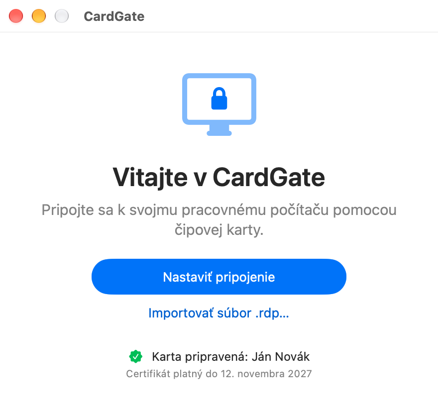
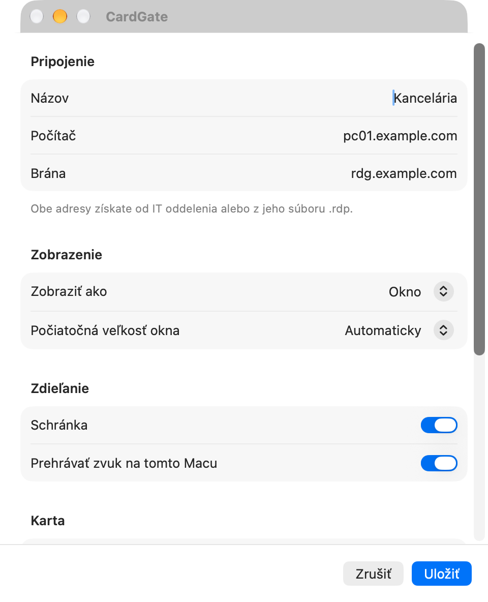
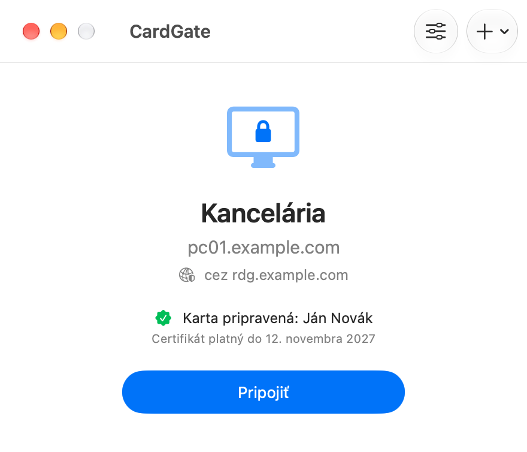
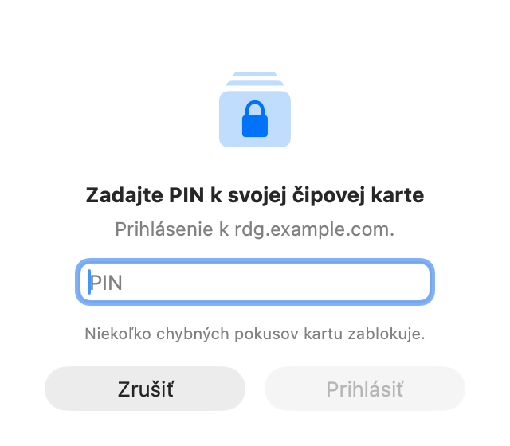
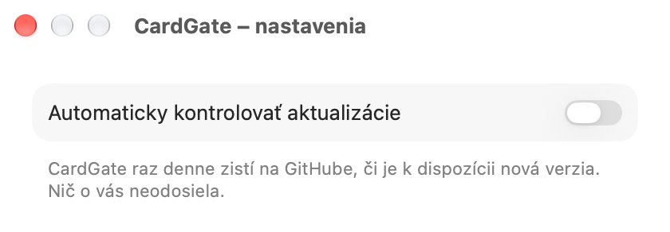

# CardGate – návod

CardGate pripojí váš Mac k vzdialenej ploche pracovného počítača cez bránu (RD Gateway),
ktorá vyžaduje prihlásenie čipovou kartou alebo tokenom.
Tento návod otvoríte aj z aplikácie: **Pomocník → Návod na CardGate**.

## Čo budete potrebovať

- Mac s procesorom Apple (M1 a novší), macOS 15 alebo novší.
- Čipovú kartu s čítačkou alebo USB token.
- Softvér ku karte s modulom PKCS#11, napr. **ProID+** pre macOS.
- Adresu svojho pracovného počítača a brány (dostanete od IT oddelenia, prípadne ako súbor `.rdp`).

## Inštalácia

1. Stiahnite `CardGate-X.Y.Z.zip` zo stránky Releases a rozbaľte ho (dvojklik).
2. Presuňte **CardGate** do priečinka **Aplikácie**.
3. Pri prvom spustení macOS aplikáciu zablokuje, pretože nie je notarizovaná u Apple.
   Kliknite na **Hotovo**, otvorte **Nastavenia systému → Súkromie a bezpečnosť**, posuňte sa nadol
   k hláseniu o aplikácii CardGate a kliknite na **Aj tak otvoriť**. Potvrďte heslom a znova **Otvoriť**.
   Tento krok je potrebný len raz (a po každej aktualizácii).

## Nastavenie pripojenia

1. Spustite CardGate a kliknite na **Nastaviť pripojenie**
   (alebo **Importovať súbor .rdp…**, ak vám ho IT oddelenie poslalo).
2. Vyplňte **Počítač** (napr. `pc01.example.com`) a **Bránu**.
3. Voliteľne zvoľte zobrazenie, počiatočnú veľkosť okna, mierku (veľkosť textu a aplikácií vo Windows; **Automaticky** = 200 % na displeji Retina, inak 100 %), schránku, zvuk a smer posúvania myšou.
   Kliknite na **Uložiť**.




## Pripojenie

1. Vložte kartu alebo token.
2. Kliknite na **Pripojiť**.
3. Zadajte **PIN** ku karte. Pozor: po niekoľkých chybných pokusoch sa karta zablokuje.
4. Otvorí sa okno so vzdialenou plochou a okno CardGate sa skryje. V Docku je stále len ikona
   CardGate: kliknutím na ňu (alebo cez ⌘Tab) sa vrátite k vzdialenej ploche. Zelené tlačidlo
   v záhlaví okna prepína celú obrazovku. Pravým tlačidlom na ikone v Docku zvolíte **Odpojiť**.
5. Po odpojení alebo zatvorení vzdialenej plochy sa okno CardGate znova zobrazí.




Klávesové skratky klienta sa používajú s klávesmi **ľavý Control + ľavý Option + ľavý Shift**
a písmenom (napr. **Enter** = celá obrazovka).

## Aktualizácie

Pri druhom spustení sa CardGate opýta, či má nové verzie hľadať automaticky (raz denne).
Voľbu zmeníte v **CardGate → Nastavenia…** (⌘,).
Ručne: menu **CardGate → Skontrolovať aktualizácie…**. Nová verzia sa nainštaluje jedným kliknutím;
aplikácia prijme len aktualizáciu podpísanú kľúčom autora. Kontrola len stiahne zoznam verzií
z GitHubu a nič o vás neodosiela.



## Bezpečnosť

- PIN sa nikde neukladá. Dialóg na PIN prijme len PIN v dĺžke, akú karta povoľuje, a upozorní,
  keď už bol skôr zadaný chybný PIN alebo ide o posledný pokus.
- Počas pripojenia je karta sprístupnená vzdialenému počítaču (kvôli prihláseniu do Windows).
  Programy vo vzdialenej relácii ju môžu používať rovnako, ako keby bola vložená priamo v ňom.
  Po skončení práce sa odpojte, prípadne kartu vytiahnite.
- Aplikácia sa pripojí len k bráne s dôveryhodným certifikátom. Ak ohlási nedôveryhodný
  certifikát, nepokračujte a kontaktujte IT oddelenie.

## Keď niečo nefunguje

| Hlásenie | Čo robiť |
|---|---|
| Na karte sa nenašiel certifikát | Vytiahnite kartu/token, znova zasuňte a skúste znova. |
| Softvér pre čipovú kartu sa nenašiel | Nainštalujte softvér ku karte (napr. ProID+). |
| Chybný PIN | Zadajte správny PIN – opakované chyby kartu zablokujú. |
| Bránu nie je možné kontaktovať | Skontrolujte pripojenie k internetu a adresu brány. |
| Pripojenie nemá zadanú bránu | CardGate sa pripája len cez bránu. Kliknite na **Upraviť pripojenie** a doplňte adresu brány. |

Podrobnosti nájdete v menu **Okno → Záznam pripojenia**; tlačidlom **Kopírovať záznam** ho môžete
poslať IT oddeleniu. Záznam neobsahuje PIN.
Záznamy posledných piatich pripojení sú aj v priečinku `~/Library/Logs/CardGate`.

## Pre správcov IT

Po dlhšom používaní (20 úspešných pripojení, najskôr po týždni) aplikácia raz nenápadne ponúkne
podporu autora; po zatvorení sa už nikdy neukáže. Ponuku možno plošne vypnúť:

```sh
defaults write io.github.jk-sw.cardgate DonationPromptDisabled -bool true
```

(alebo konfiguračným profilom pre doménu `io.github.jk-sw.cardgate`).
