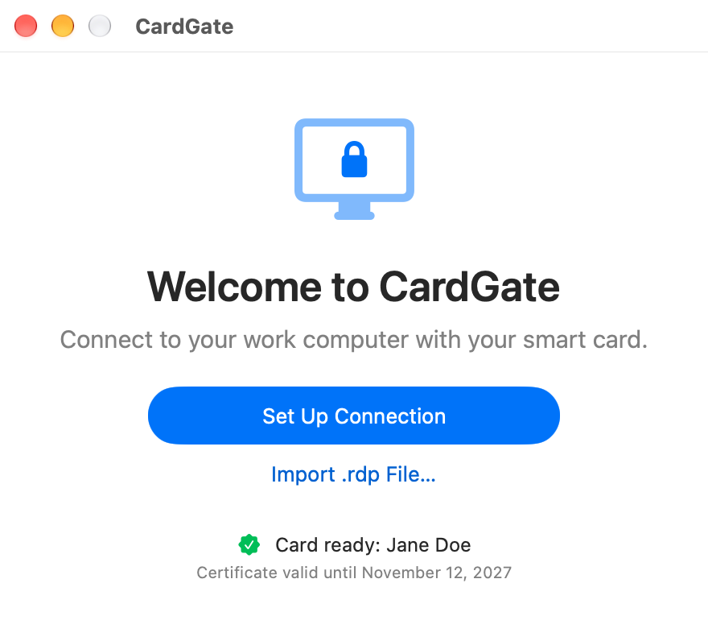
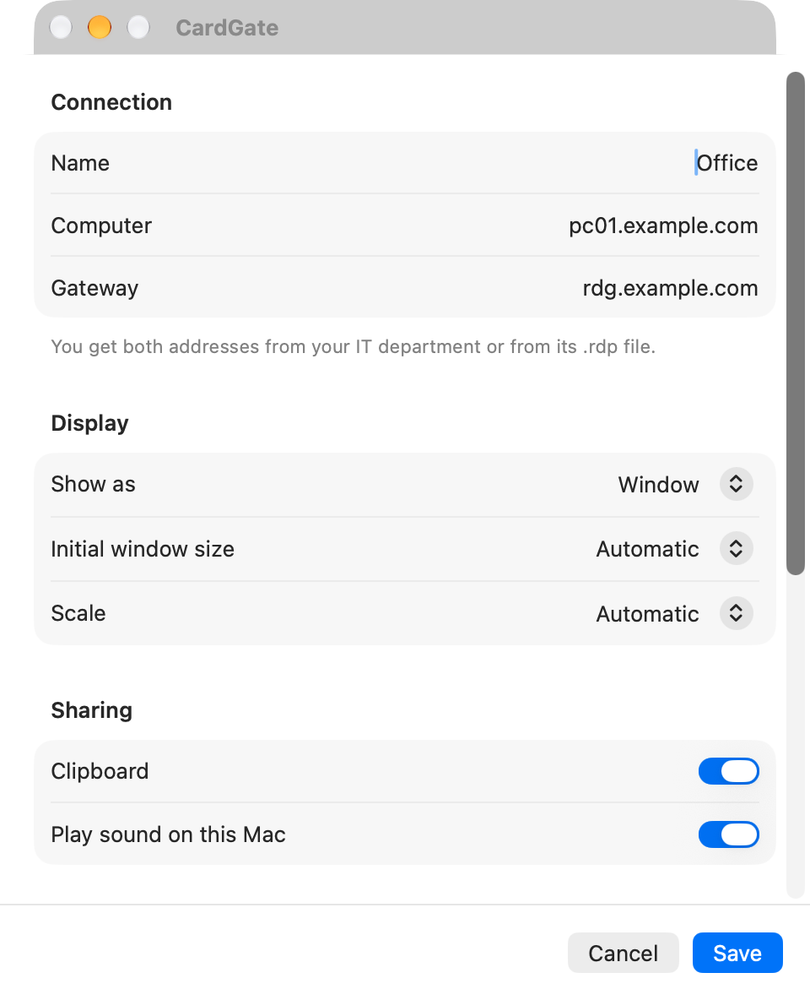
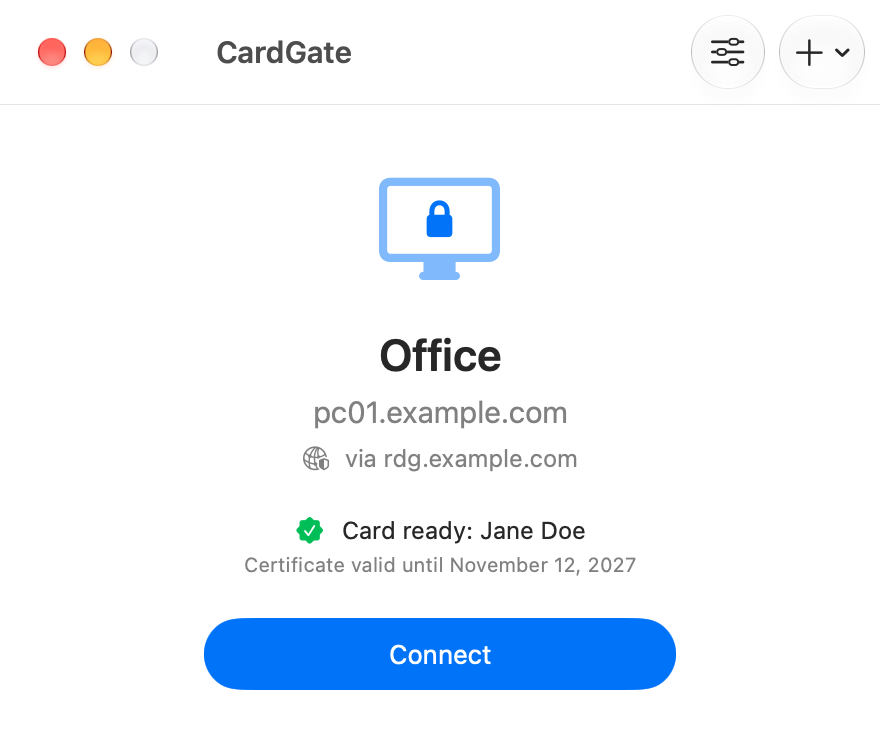
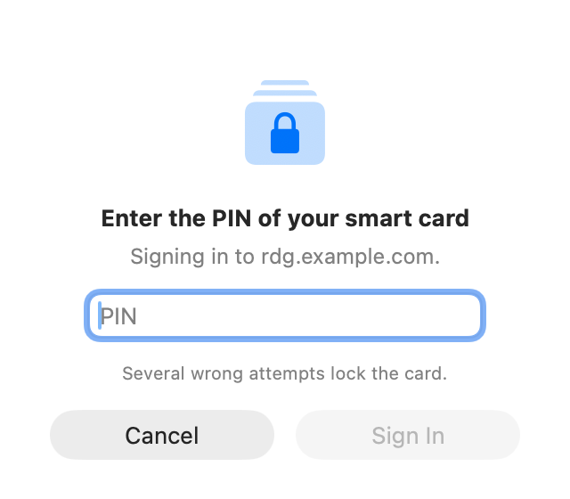
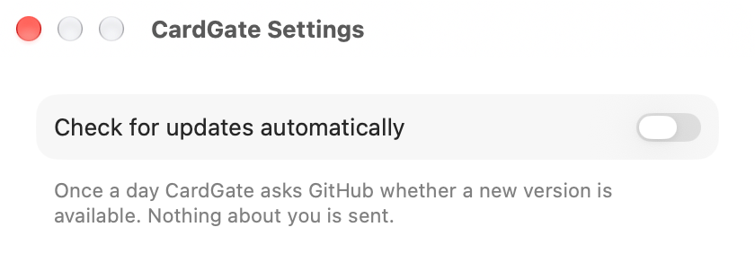

# CardGate – user guide

CardGate connects your Mac to the remote desktop of your work computer through a Remote Desktop
Gateway that requires smart card (or token) sign-in.
You can also open this guide from the app: **Help → CardGate User Guide**.

## Requirements

- Mac with Apple silicon (M1 or later), macOS 15 or later.
- Smart card with a reader, or a USB token.
- Smart card software with a PKCS#11 module, e.g. **ProID+** for macOS.
- Address of your work computer and of the gateway (from your IT department, or in an `.rdp` file).

## Installation

1. Download `CardGate-X.Y.Z.zip` from the Releases page and unzip it (double-click).
2. Move **CardGate** to the **Applications** folder.
3. On first launch macOS blocks the app because it is not notarized by Apple. Click **Done**, open
   **System Settings → Privacy & Security**, scroll down to the message about CardGate and click
   **Open Anyway**. Confirm with your password and click **Open**. This is needed once (and after
   each update).

## Setting up a connection

1. Start CardGate and click **Set Up Connection** (or **Import .rdp File…**).
2. Enter the **Computer** (e.g. `pc01.example.com`) and the **Gateway**.
3. Optionally choose the display mode (full screen by default, or a window), initial window size, scale (size of text and apps in Windows; **Automatic** = 200 % on a Retina display, otherwise 100 %), clipboard, sound and scroll direction.
   Click **Save**.




## Connecting

1. Insert your card or token.
2. Click **Connect**.
3. Enter the **PIN** of your card. Several wrong attempts lock the card.
4. The remote desktop opens and the CardGate window hides. The Dock still shows only CardGate:
   click it (or use ⌘Tab) to return to the remote desktop. The green button in the window's title
   bar switches full screen. Right-click the Dock icon for **Disconnect**.
5. When you disconnect or close the remote desktop, the CardGate window comes back.

**CardGate → Settings…** (⌘,) has three options, all on by default:
- **Keep the connection alive and restore it after an outage** – after a short network outage
  CardGate connects again on its own, without a new PIN. Meanwhile the desktop shows its last picture
  and does not respond; a small window over it says "The connection was interrupted. Reconnecting…"
  and has a Disconnect button. It gives up after 2.5–5 minutes.
- **Keep the Mac awake while connected** – the Mac does not sleep when idle and the connection stays
  up; the display may turn off as set in macOS. Closing the lid or choosing Sleep still puts it to sleep.
- **Ask before disconnecting** – closing the remote desktop window (or ⌘Q in it) asks first.
  **Disconnect** in CardGate or in the Dock does not ask.




Client hotkeys use **left Control + left Option + left Shift** plus a key (e.g. **Return** = full screen).

## Updates

On its second launch CardGate asks whether to look for new versions automatically (once a day).
Change it in **CardGate → Settings…** (⌘,).
Manually: **CardGate → Check for Updates…**. A new version installs with one click; the app only
accepts updates signed with the author's key. A check only downloads the list of versions from
GitHub and sends nothing about you.



## Security

- The PIN is never stored. The PIN dialog accepts only PINs of the length the card allows and warns
  when a wrong PIN was entered before or this is the last attempt. While connected the PIN stays
  only in the client's memory (to sign in to Windows and to reconnect after an outage); a PIN the
  card rejected is never used again.
- While connected, the card is made available to the remote computer (for the Windows sign-in).
  Programs in the remote session can use it as if it were inserted there. Disconnect when you are
  done, or remove the card.
- The app connects only to a gateway with a trusted certificate. If it reports an untrusted
  certificate, do not continue and contact your IT department.
- The gateway's certificate must be issued by a publicly trusted certificate authority. The app
  does not accept a certificate of an internal (company) authority, even if the Mac trusts it (for
  example in Keychain or through device management): it reports that the gateway's certificate is
  not publicly trusted.

## Troubleshooting

| Message | What to do |
|---|---|
| No certificate found on the card | Remove the card or token, insert it again and retry. |
| No smart card software found | Install the software for your card (e.g. ProID+). |
| Wrong PIN | Enter the correct PIN – repeated mistakes lock the card. |
| The card refused the sign-in | The PIN may have been wrong, or the card or reader failed. Remove the card, insert it again and connect. Repeated wrong PINs lock the card. |
| The card's key type is not supported | Only cards with an RSA key can sign in to the gateway. Contact your IT department. |
| The gateway cannot be reached | Check your internet connection and the gateway address. |
| The connection has no gateway | CardGate connects only through an RD Gateway. Click **Edit Connection** and add the gateway address. |

Details are in **Window → Connection Log**; **Copy Log** lets you send it to your IT department.
The log never contains the PIN.
The logs of the last five connections are also in the folder `~/Library/Logs/CardGate`.

## For IT administrators

After a while (20 successful connections, at the earliest after a week) the app once shows an
unobtrusive offer to support the author; once closed it never appears again. To turn it off:

```sh
defaults write io.github.jk-sw.cardgate DonationPromptDisabled -bool true
```

(or with a configuration profile for the `io.github.jk-sw.cardgate` domain).
