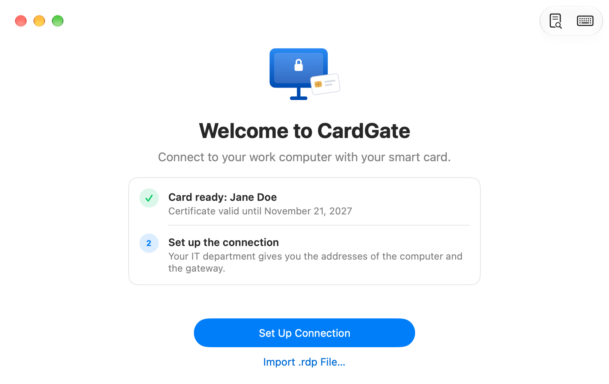
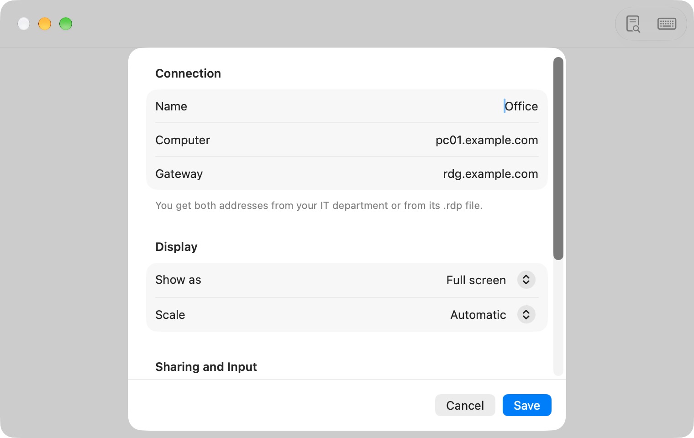
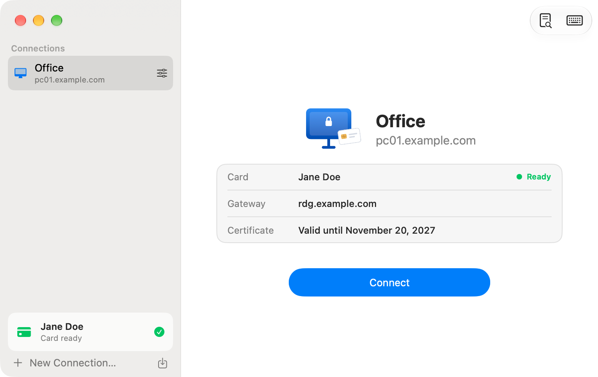
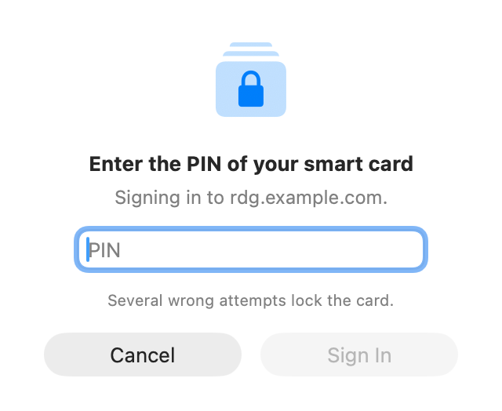
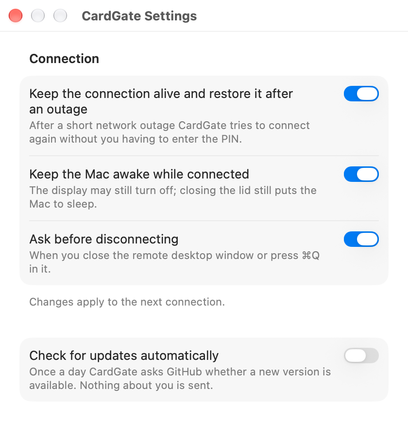

# CardGate – user guide

CardGate connects your Mac to the remote desktop of your work computer through a Remote Desktop
Gateway that requires smart card (or token) sign-in.
You can also open this guide from the app: **Help → CardGate User Guide**.

## Requirements

- Mac with Apple silicon (M1 or later), macOS 15 or later.
- Smart card with a reader, or a USB token.
- Smart card software with a PKCS#11 module, e.g. **ProID+** for macOS.
- Address of your work computer and of the gateway (from your IT department, or in an `.rdp` file).

## Installation

1. Download `CardGate-X.Y.Z.zip` from the Releases page and unzip it (double-click).
2. Move **CardGate** to the **Applications** folder.
3. On first launch macOS blocks the app because it is not notarized by Apple. Click **Done**, open
   **System Settings → Privacy & Security**, scroll down to the message about CardGate and click
   **Open Anyway**. Confirm with your password and click **Open**. This is needed only once.

## Setting up a connection

1. Start CardGate and click **Set Up Connection** (or **Import .rdp File…**). Connect only to
   addresses from your IT department: while connected, the remote computer can use your card.
2. Enter the **Computer** (e.g. `pc01.example.com`) and the **Gateway**.
3. Optionally choose the display mode (full screen by default, or a window), for full screen with several
   displays also the display (**Main display** = the one with the menu bar; if the chosen display is not
   connected, it opens on the main one), initial window size (**Automatic** = 80 % of the screen), scale (size
   of text and apps in Windows; **Automatic** = 200 % on a Retina display, otherwise 100 %), clipboard, sound
   and scroll direction.
   Click **Save**.

You can have several connections: they are listed on the left. Edit one with the button next to its
name; add another with **New Connection…** below the list.

Settings you rarely change are under **Advanced** (click to open; card certificate, security, sign-in to
Windows and card module). Leave **Security** at **Automatic**: CardGate uses the strongest security the
computer accepts (NLA, TLS or RDP Security), remembers it and after about a month tries whether the computer
accepts stronger security. The parentheses show what is used now, e.g. **Automatic (NLA)**. Choose NLA, TLS
or RDP Security only if your IT department tells you to.

**Sign in to Windows**: the default **With the card** signs you in to Windows with the card (with NLA
without another PIN). If Windows on the computer does not accept the card (e.g. it shows an error before its
sign-in screen), choose **With user name and password**: the card still signs you in to the gateway, but
Windows shows its sign-in screen and asks for your password. If Windows offers the card's PIN, choose
**Sign-in options** and the password; next time it usually offers the password right away. The card stays
available in Windows (e.g. for signing).




## Connecting

1. Insert your card or token.
2. Click **Connect**. Until the desktop opens, **Cancel** stops the attempt.
3. Enter the **PIN** of your card. Several wrong attempts lock the card.
   With NLA this PIN signs you in to Windows too. Without NLA, Windows asks for the PIN once more on its
   sign-in screen (if it offers a password, choose the smart card sign-in).
4. The remote desktop opens and the CardGate window hides. The Dock still shows only CardGate:
   click it (or use ⌘Tab) to return to the remote desktop. The green button in the window's title
   bar switches full screen. Right-click the Dock icon for **Disconnect**.
   On the right of the title bar is the scale of the remote desktop (e.g. 150%): the magnifiers make it
   smaller or larger, a click on the number offers a list (including the scale when connected). Windows
   resizes text and apps at once, without disconnecting; the next connection uses the scale of the
   connection settings again. The button next to it opens the connection log. In full screen, move the
   pointer to the top edge to show the title bar.
5. When you disconnect or close the remote desktop, the CardGate window comes back.

**CardGate → Settings…** (⌘,) has three options, all on by default:
- **Keep the connection alive and restore it after an outage** – after a short network outage
  CardGate connects again on its own, without a new PIN. Meanwhile the desktop shows its last picture
  and does not respond; a small window over it says "The connection was interrupted. Reconnecting…"
  and has a Disconnect button. It gives up after 2.5–5 minutes. The card must be in the reader: without
  it reconnecting fails (CardGate says no certificate was found on the card).
- **Keep the Mac awake while connected** – the Mac does not sleep when idle and the connection stays
  up; the display may turn off as set in macOS. Closing the lid or choosing Sleep still puts it to sleep.
- **Ask before disconnecting** – closing the remote desktop window (or ⌘Q in it) asks first.
  **Disconnect** in CardGate or in the Dock does not ask.




Client hotkeys use **left Control + left Option + left Shift** plus a key (e.g. **Return** = full screen).

## Updates

On its second launch CardGate asks whether to look for new versions automatically (once a day).
Change it in **CardGate → Settings…** (⌘,).
Manually: **CardGate → Check for Updates…**. A new version installs with one click; the app only
accepts updates signed with the author's key. A check only downloads the list of versions from
GitHub and sends nothing about you.



## Security

- The PIN is never stored. The PIN dialog accepts only PINs of the length the card allows and warns
  when a wrong PIN was entered before or this is the last attempt. While connected the PIN stays
  only in the client's memory (to sign in to Windows and to reconnect after an outage); a PIN the
  card rejected is never used again.
- While connected, the card is made available to the remote computer (for the Windows sign-in).
  Programs in the remote session can use it as if it were inserted there. Disconnect when you are
  done, or remove the card.
- The app connects only to a gateway with a trusted certificate. If it reports an untrusted
  certificate, do not continue and contact your IT department.
- The gateway's certificate must be issued by a publicly trusted certificate authority. The app
  does not accept a certificate of an internal (company) authority, even if the Mac trusts it (for
  example in Keychain or through device management): it reports that the gateway's certificate is
  not publicly trusted.
- With NLA and TLS the connection between the gateway and the computer is encrypted with TLS. RDP
  Security uses the older RC4 cipher; Automatic uses it only for a computer that accepts nothing else.
  With NLA the computer also verifies your card before it shows its sign-in screen.
- CardGate remembers the computer's certificate on the first connection. If it changes later, the
  connection is stopped (**The computer's certificate changed**). Accept it with **Trust the New
  Certificate** only if the computer's administrator confirms it was renewed and its SHA-256
  fingerprint matches the one in the message. With NLA, CardGate accepts a renewed certificate by
  itself: when you sign in with the card (Kerberos), the computer proves it is still the same one
  before CardGate sends it your sign-in credentials.
- Automatic security never silently switches to weaker security. If the computer used to accept TLS or
  NLA and now offers only weaker security, CardGate does not connect until you click **Connect with
  Weaker Security**; do not do that without the administrator's confirmation.

## Troubleshooting

| Message | What to do |
|---|---|
| No certificate found on the card | Remove the card or token, insert it again and retry. |
| No smart card software found | Install the software for your card (e.g. ProID+). |
| Wrong PIN | Enter the correct PIN – repeated mistakes lock the card. |
| The card refused the sign-in | The PIN may have been wrong, or the card or reader failed. Remove the card, insert it again and connect. Repeated wrong PINs lock the card. |
| The card's key type is not supported | Only cards with an RSA key can sign in to the gateway. Contact your IT department. |
| The gateway cannot be reached | Check your internet connection and the gateway address. |
| The connection has no gateway | CardGate connects only through an RD Gateway. Click **Edit Connection** and add the gateway address. |
| The connection was interrupted | The network failed and reconnecting did not succeed (or it is off in Settings). Check your internet connection and connect again. |
| The smart card module is not from a verified publisher | The card module does not come from a verified maker. Use it (**Use This Module…**) only if you know where it is from (e.g. your IT department). |
| The smart card module set for this connection was not found | Fix the path in **Edit Connection** (section Advanced), or leave it empty. |
| The computer requires stronger connection security | In the connection settings choose **Security: Automatic**. If it is already chosen, the computer requires NLA, which could not be used – follow the message or contact your IT department. |
| The computer offers only weaker connection security | If the computer's administrator changed this on purpose, click **Connect with Weaker Security**. Otherwise do not connect and contact your IT department. |
| The computer's certificate changed | Trust the new certificate only when the administrator confirms its renewal and fingerprint (see Security). |
| Your account may not connect to this computer | Ask the computer's administrator to add you to the Remote Desktop Users. |
| This Mac's time differs from the domain's | Check the date and time in System Settings → General → Date & Time, then connect again. |
| The domain does not know this computer | Enter the computer's full name with its domain (e.g. `pc01.example.com`) in the connection settings. |
| The gateway does not allow connecting to this computer | Check the computer's full name; if it is correct, contact your IT department. |
| The gateway is temporarily unavailable | The gateway is overloaded or in maintenance. Try again in a while. |
| Your account is disabled / locked, Your account has expired | Contact your IT department. |
| The computer has no remote desktop license | Contact your IT department. |
| The remote desktop program quit unexpectedly | Connect again. If it happens again, report it in Issues and attach the archive from **Save Log…** (see below). |
| Windows shows an error when signing in with the card (e.g. "Hash generation … is not enabled on the server") | Windows on this computer does not accept the card. In the connection settings choose **Sign in to Windows: With user name and password**. |
| Signing in to the computer with the card failed | Connect again; CardGate then connects without NLA. If the computer requires NLA, contact your IT department (the gateway needs a KDC proxy). |
| NLA cannot be used for this connection | Enter the computer's full name with its domain (e.g. `pc01.example.com`) and check your internet connection, or the connection to your organization's network (the card's certification authority is downloaded). |

Details are in **Window → Connection Log**. By default (**Important**) it shows the course of the
connection in words: warnings in orange (e.g. weaker RDP Security, a network outage or the card
removed from the reader), errors in red.
**Details** shows every line of the log; known harmless messages are gray. **Copy Log** copies what the
window shows (the important messages, or the whole log). **Save Log…** saves a ZIP archive with three
files – the important messages (`important.txt`), the whole log with every detail (`connection.log`) and
anonymous diagnostic information (`diagnostics.txt`: app and macOS versions, Mac model, displays, the
card's software and type, connection settings without addresses) – to send it to your IT department. The
computer's and gateway's names, the connection's name and the Windows account are replaced with `***` in
the archive, so it can be sent as it is. The log never contains the PIN.
The logs of the last five connections are also in the folder `~/Library/Logs/CardGate`.

Report a bug or an idea in [Issues](https://github.com/JK-SW/cardgate/issues) and attach the archive from
**Save Log…** (a copied log contains the computer's and gateway's names). Report a security problem privately
([Report a vulnerability](https://github.com/JK-SW/cardgate/security/advisories/new)).

## For IT administrators

After a while (20 successful connections, at the earliest after a week) the app once shows an
unobtrusive offer to support the author; once closed it never appears again. To turn it off:

```sh
defaults write io.github.jk-sw.cardgate DonationPromptDisabled -bool true
```

(or with a configuration profile for the `io.github.jk-sw.cardgate` domain).

**Security of the connection to the computer.** CardGate supports NLA, TLS and RDP Security; Automatic
uses the strongest one the computer accepts. NLA is recommended (one PIN, the computer verifies the card
before the sign-in). NLA with the card needs:
- the KDC proxy published on the RD Gateway (`https://<gateway>/KdcProxy`), through which CardGate
  authenticates the card with a domain controller (Kerberos PKINIT),
- the computer's name in the Active Directory DNS domain: the realm is the name's suffix in upper case
  (`pc01.example.com` → `EXAMPLE.COM`); for a computer in another DNS zone NLA fails and CardGate connects
  without it,
- domain controller certificates issued under the same root certification authority as the card
  certificates (CardGate downloads it from the addresses in the card certificate and keeps it),
- users allowed to sign in through Remote Desktop,
- the Mac's clock in step with the domain's (Kerberos; otherwise CardGate reports the time difference and
  connects without NLA).

On the computer, security is set by Group Policy in **Computer Configuration → Administrative Templates →
Windows Components → Remote Desktop Services → Remote Desktop Session Host → Security**: "Require use of
specific security layer for remote (RDP) connections" = **SSL** and "Require user authentication for remote
connections by using Network Level Authentication" = **Enabled**.
